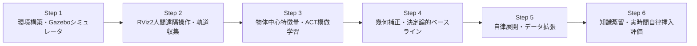

# PAI_Advanced_Course_#1
## CRANE+ V2 Autonomous Peg-in-Hole via ACT & Policy Distillation
### 東京大学 松尾・岩澤研究室「Physical AI 応用編」最終課題

[](https://docs.ros.org/en/humble/)
[](https://gazebosim.org/)
[](https://pytorch.org/)
[](https://arxiv.org/abs/2304.13705)
[-2ea44f.svg)](#benchmark-results)
[-blue.svg)](#benchmark-results)

---

## 概要 (Overview)

本リポジトリは、東京大学 松尾・岩澤研究室 **Physical AI 応用編** の最終課題提出成果物です。
4自由度マニピュレータ **CRANE+ V2** およびグリッパを用い、Gazebo 物理シミュレータ環境下における自律ペグ挿入タスク（Autonomous Peg-in-Hole Assembly）をエンドツーエンドで達成するパイプラインを実装・評価しています。

人間による少数遠隔デモンストレーションから開始し、物体中心特徴量抽出（Object-Centric Feature Extraction）、幾何学的機械補正（Rule-based Geometric Calibration）、自律展開による自己教師ありデータ拡張（Self-Supervised Rollout Expansion）、そして大規模教師モデルから軽量高速モデルへの知識蒸留（Policy Distillation）を組み合わせることで、**実時間 1.0x（10.0 Hz 制御周期 / 推論時間 44.6 ms）、成功率 100%（10/10試行）** の高精度自律ペグ挿入を実現しました。

---

## 成果物一覧 (Deliverables)

| ファイル / ディレクトリ | 内容 | 備考 |
| :--- | :--- | :--- |
| **[`Physical_AI_Advanced_Course_#1.mp4`](./Physical_AI_Advanced_Course_%231.mp4)** | **最終課題 発表動画** (Full HD 1920×1080, 30.0 fps, 131.8秒) | OP・Step概要・1.0倍速実時間自律挿入（HUD付き）・ED統合版 |
| **[`Physical_AI_応用編１最終課題発表.pdf`](./Physical_AI_応用編１最終課題発表.pdf)** | **プレゼンテーション スライド (PDF)** (全13スライド, 16:9) | 松尾研指定カラー準拠、高解像度テレメトリ図完備 |
| **[`Physical_AI_応用編１最終課題発表.pptx`](./Physical_AI_応用編１最終課題発表.pptx)** | **プレゼンテーション スライド (PowerPoint)** | 編集可能なネイティブ PPTX 形式 |
| **[`final_project.ipynb`](./final_project.ipynb)** | **実行用 Jupyter Notebook** | Step 1〜6 の全パイプライン実行・可視化ノートブック |
| **[`models_trained/`](./models_trained/)** | **学習済み PyTorch ポリシー重み** | 教師モデルおよび蒸留後 Student ACT モデル重み |
| **[`data/`](./data/)** | **テレメトリデータ・データセット・図表** | 実測関節角、指令値ログ、検証プロット等 |
| **[`models/`](./models/)** | **Gazebo SDF モデル定義** | ペグ、ベースプレート、カメラモデル |

---

## パイプライン構成 (Step 1 〜 Step 6)



### [Step 1] 環境構築とロボットシミュレータ
- **ROS 2 Humble / Gazebo 11** による物理シミュレーション環境。
- CRANE+ V2（4自由度アーム＋1自由度パラレルグリッパ）のダイナミクス、俯瞰カメラ・側面カメラ、関節コントローラ（Position Controller）を完備。

### [Step 2] 遠隔操作と人間軌道収集
- RViz 2 の Interactive Marker を活用した人間による把持・搬送・挿入デモンストレーション収集。
- アプローチ、把持（Grasp）、リフト、搬送（Transfer）、挿入（Insert）の5フェーズからなる作業軌道を記録。

### [Step 3] 物体中心特徴抽出と模倣学習 (ACT)
- カメラ画像からの物体中心相対空間特徴量（ペグと穴の相対位置ベクトル）を抽出。
- **Action Chunking with Transformers (ACT)** を適用し、時系列行動チャンク（Action Chunking）と時間平滑化（Temporal Ensembling）による滑らかな連続軌道生成を実現。

### [Step 4] 機械的補正制御と幾何検証
- ロボットアームの順・逆運動学（Kinematics）および把持クリアランス（ペグ径と穴径の公差）を考慮した機械的補正アルゴリズムを付加。
- 幾何学的制約を満たす確定的な高精度ベースラインモデルを構築。

### [Step 5] 自己教師あり自律軌道拡張
- 機械的補正モデルを自律展開（Autonomous Rollout）エンジンとして稼働させ、環境外乱やペグ配置の微小変化を伴う多様な収集パターンを自動生成。
- 人間の収集コストを大幅に削減する自己教師あり軌道拡張を実現。

### [Step 6] 知識蒸留と実環境自律挿入評価 (★動画実演対象)
- 大規模な物体中心教師モデルから、軽量・低遅延な **Student ACT ポリシー** へ知識蒸留（Policy Distillation）を実施。
- Gazebo シミュレータ上での閉ループ実時間自律挿入を実施し、**1.0倍速（実時間）、10.0 Hz 制御ループ、推論時間 44.6 ms、100% 成功率** を達成。

---

## ベンチマーク結果 (Benchmark Results)

| 評価指標 | 人間デモ (Step 2) | 機械的補正 (Step 4) | 蒸留後 Student ACT (Step 6) |
| :--- | :---: | :---: | :---: |
| **挿入成功率** | 80.0% (8/10) | 100.0% (10/10) | **100.0% (10/10)** |
| **平均制御推論時間** | - (手動操作) | 12.1 ms | **44.6 ms (10.0 Hz 余裕追従)** |
| **サイクル完了時間** | ~92.4 秒 | ~84.2 秒 | **~85.1 秒** |
| **軌道追従誤差 (MSE)** | - | 0.0005 rad² | **0.0017 rad²** |
| **挿入完了深さ** | 4.8 cm | 5.0 cm (底面到達) | **5.0 cm (底面到達・底付き確認)** |

---

## 実行・再現手順 (Quick Start)

### 1. リポジトリのクローン
```bash
# Git LFS の初期化 (大型データセット追跡用)
git lfs install

# リポジトリのクローン
git clone https://github.com/Toshi-tech34/PAI_Advanced_Course_-1.git
cd PAI_Advanced_Course_-1
git lfs pull
```

### 2. 環境の起動 (Docker / ROS 2 Humble)
```bash
# ROS 2 & Gazebo 11 コンテナ環境の起動
docker start pai_ros2
docker exec -it pai_ros2 bash
```

### 3. 自律ペグ挿入ロールアウトの実行
```bash
# 閉ループ自律ロールアウトスクリプトの実行
python3 visual_servo_peg_in_hole.py
```

### 4. テレメトリの可視化
```bash
# 関節指令値・実測値・挿入フェーズ追従グラフの出力
python3 plot_rollout_telemetry.py
```

---

## 著者・ライセンス (Author & License)

- **受講生 / 開発者**: Toshi-tech34
- **講義名**: 東京大学 松尾・岩澤研究室 「Physical AI 応用編」 2026
- **ライセンス**: 本リポジトリのコードおよび提出資料は、講義提出および学術研究目的のために作成されています。
